# Heaven's Kitchen: Diseño de Interfaz y Prototipo de Videojuego

*Materia: ingenieria en sistemas de informacion  · Equipo: Ibarra Padilla Sebastian, Martiez Ruiz Josue Ignacio, Ortega Molin Marco Sebastian*

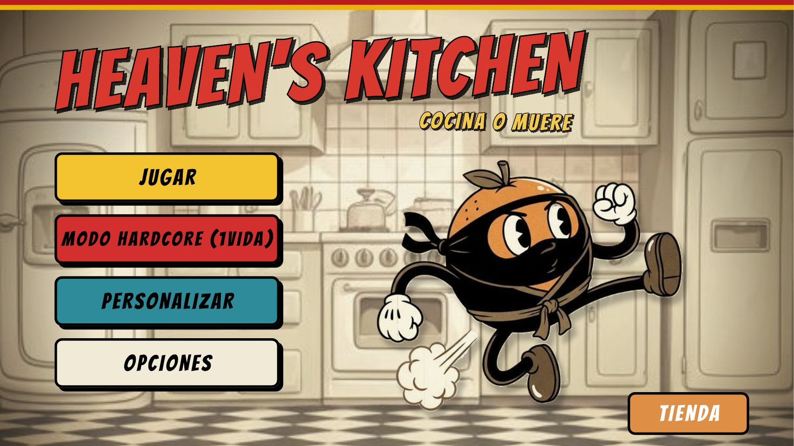

📄 **[Ver la vista previa completa del juego (PDF)](docs/Heavens-Kitchen-Vista-Previa.pdf)**

## 1. Descripción

Diseño en **Figma** del prototipo visual e interactivo de **Heaven's Kitchen**, un videojuego de peleas ambientado en una cocina, donde frutas luchan contra electrodomésticos como una licuadora. El prototipo incluye las pantallas principales del juego y las transiciones entre ellas. Todo tiene un estilo ilustrado retro de dibujo animado antiguo, inspirado principalmente en *Cuphead*.

## 2. Requerimientos

Pantallas y funciones que debía cubrir el prototipo:

- Menú de inicio con **modo normal** y **modo hardcore** (una sola vida).
- **Selección de guerrero**.
- **Personalización de la fruta** (tipo, ropa y arma) con sus estadísticas de salud, daño y velocidad.
- **Tienda** para conseguir outfits, armas y frutas.
- **Escena de combate** con barras de vida y monedas.
- Pantallas de **pausa**, **opciones**, **Game Over** y **Knockout**.
- Estilo visual retro de dibujo animado antiguo, coherente en todas las pantallas.
- Menús fáciles de usar e intuitivos.

## 3. ¿Cómo se diseñó la solución?

- **Dirección artística:** estilo ilustrado retro, inspirado en *Cuphead*, con tipografía y botones de colores llamativos (amarillo, rojo, azul y crema) para mantener una identidad visual única en todo el juego.
- **Personajes:** cada fruta tiene su propia identidad, como *Ninjaranja*, *Platakingo* y *Manzanafia*, además de otras frutas como *Uva*, *Limoncito* y *Sandiabolica*. El enemigo es *La Licuadora Suprema*.
- **Navegación:** el flujo va del menú principal a la selección de guerrero, la pantalla de enfrentamiento y el combate, con accesos a personalización, tienda y opciones.
- **Organización en equipo:** nos repartimos las pantallas y los personajes, y cuidamos que todo mantuviera el mismo estilo mediante comunicación constante y retroalimentación entre integrantes.

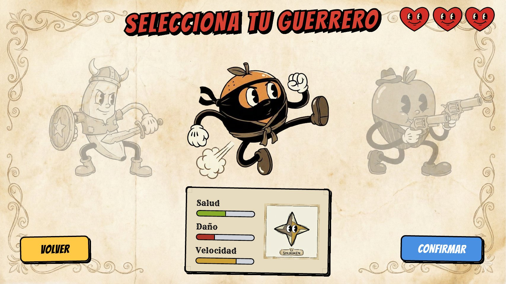

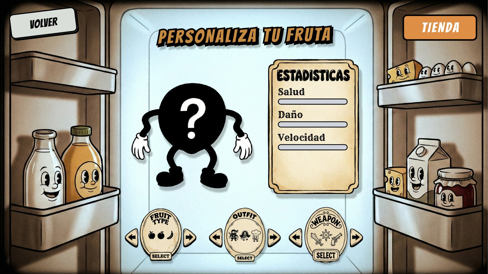

## 4. ¿Cómo se implementó la solución?

1. **Diseño de las pantallas en Figma:** menú principal, opciones, selección de guerrero, pantalla de enfrentamiento, personalización de la fruta, tienda, escena de combate, pausa, Game Over y Knockout.
2. **Estadísticas de personajes y armas:** las pantallas de selección y personalización muestran barras de salud, daño y velocidad.
3. **Prototipo interactivo:** conectamos las pantallas con transiciones para recorrer el juego como si fuera real, por ejemplo, pasar del menú a la selección de guerrero y de ahí al combate con la instrucción "Presiona Enter para luchar".
4. **Trabajo colaborativo:** usamos las herramientas de comunicación de Figma, incluido el chat de voz, para coordinarnos y dar retroalimentación en tiempo real.

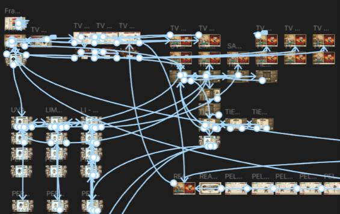

**Dificultad:** conectar las ideas de cada integrante para que el juego tuviera un sentido lógico fue lo más complicado.

## 5. ¿Cuál fue el resultado?

Se obtuvo un prototipo interactivo y visualmente coherente, con el flujo completo del juego: desde el menú hasta el combate, la tienda y las pantallas de victoria y derrota.

### Modos de juego

| Modo normal | Modo hardcore (1 vida) |
|---|---|
| 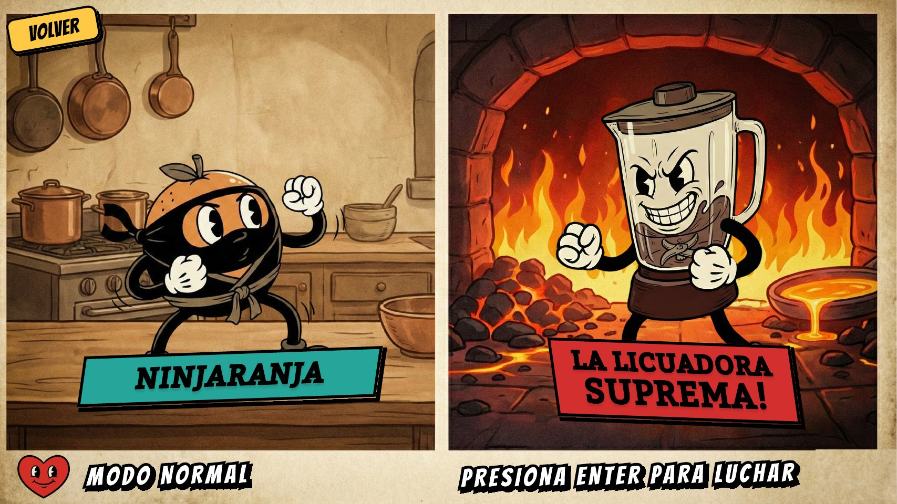 | 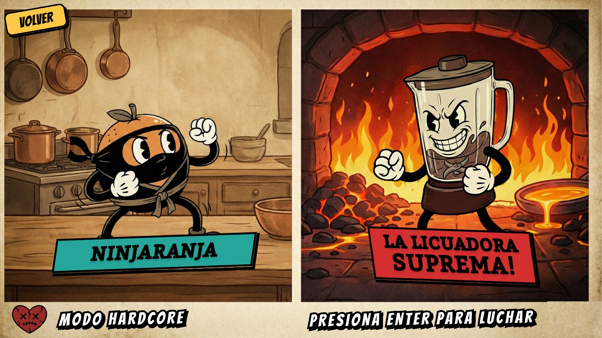 |

### Tienda

| Tienda | Libro de frutas |
|---|---|
| 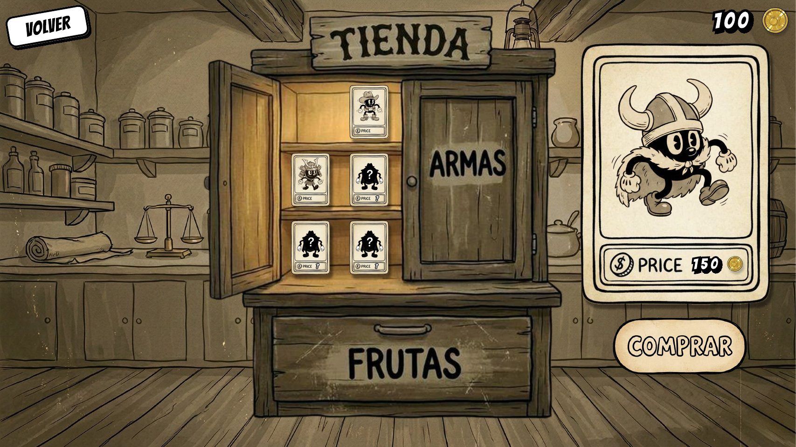 | 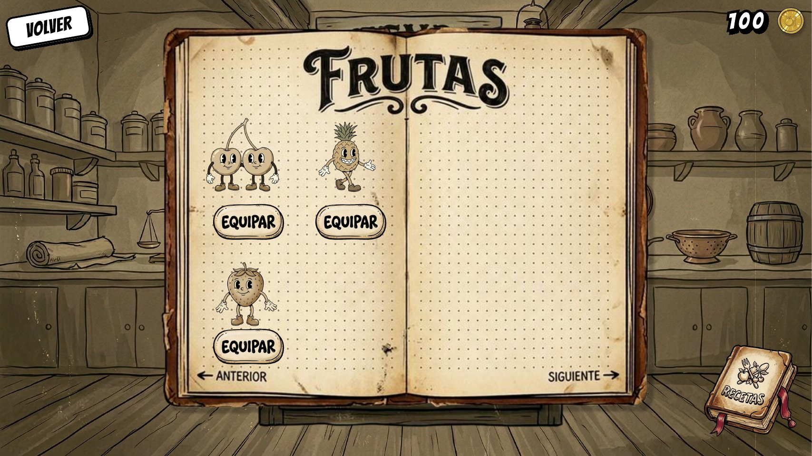 |

### Combate

| Combate | Ataque de La Licuadora Suprema |
|---|---|
| 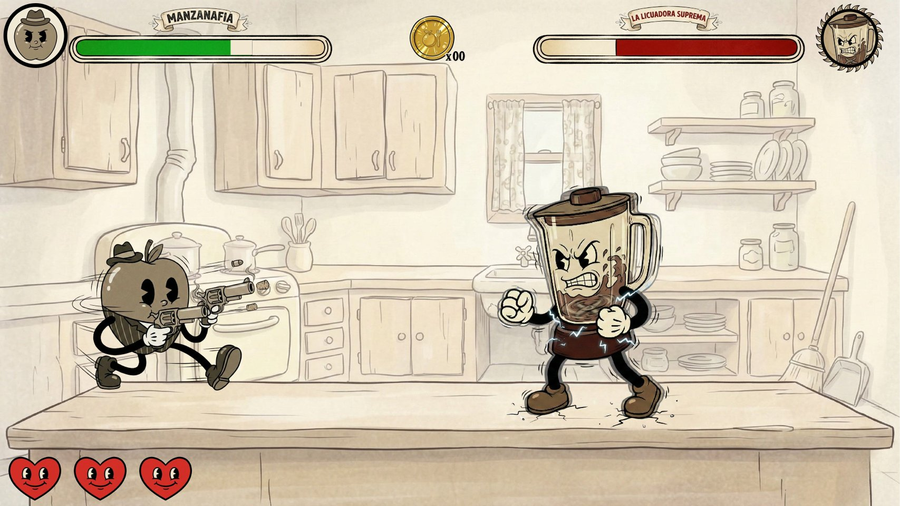 | 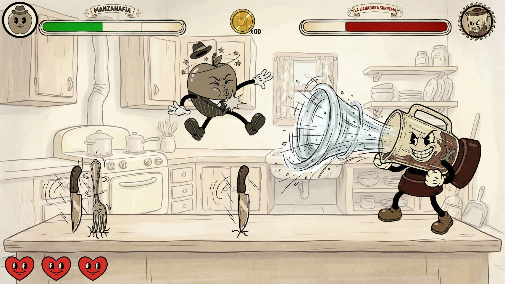 |

### Pausa, derrota y victoria

| Pausa | Game Over | Knockout |
|---|---|---|
| 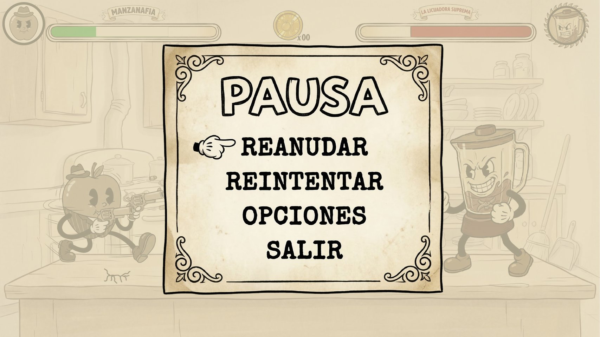 | 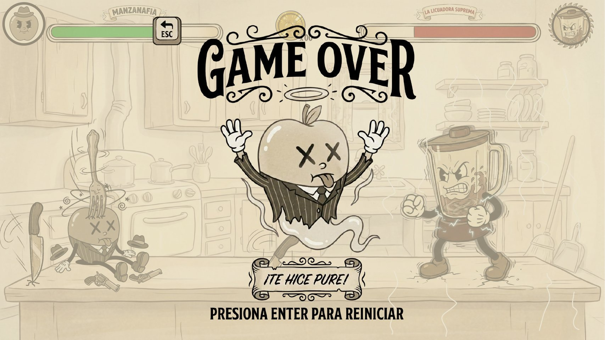 | 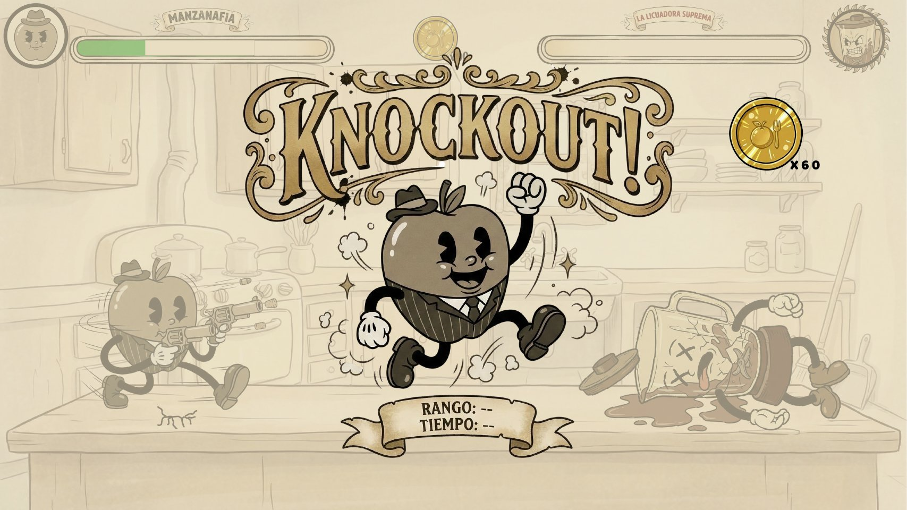 |

Para ver todas las pantallas seleccionadas en un solo documento, abre la **[vista previa en PDF](docs/Heavens-Kitchen-Vista-Previa.pdf)**.

**Lo que aprendí:** a diseñar interfaces de videojuego y armar un prototipo interactivo con transiciones en Figma. También practiqué el diseño de menús intuitivos y reforcé mi creatividad y la capacidad de pensar en el usuario (en este caso, el jugador). Me dejó bases de diseño UI/UX que sirven para planear una aplicación antes de programarla, y aprendí a trabajar en equipo manteniendo un estilo visual común.

## Autores

**Sebastian Ibarra Padilla** · [GitHub](https://github.com/sebastianibar)
**Josue Ignacio Martniez Ruiz** · [GitHub](https://github.com/Lalocarrito)
**Marco Sebastian Ortega Molina** · [GitHub](https://github.com/MarcoSebastianOrtegaMolina)